

  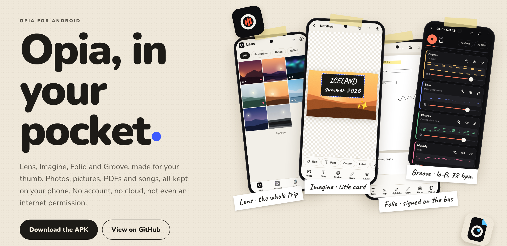

<h1 align="center">Opia for Android</h1>

  <b>Photos, pictures, PDFs and songs on your phone. No account, no cloud, and offline unless you allow update checks.</b>

  <a href="https://github.com/kanisakhpara-devs/Opia-for-Android/releases/latest/download/Opia.apk"><b>Download Opia.apk</b></a> ·
  <a href="https://kanisakhpara-devs.github.io/Opia-for-Android/"><b>Website</b></a> ·
  <a href="#-install"><b>Install</b></a> ·
  <a href="CHANGELOG.md"><b>Changelog</b></a> ·
  <a href="https://github.com/kanisakhpara-devs/Opia-for-Windows"><b>Opia for Windows</b></a>

---

**Opia for Android** is the phone version of [Opia for Windows](https://github.com/kanisakhpara-devs/Opia-for-Windows), built for touch. It has four workspaces: **Lens** for photos, **Imagine** for pictures, **Folio** for PDFs and **Groove** for music. Everything runs and stays on the phone. The app doesn't have the internet permission, so it couldn't send your files anywhere even if it wanted to.

<table>
  <tr>
    <td width="25%">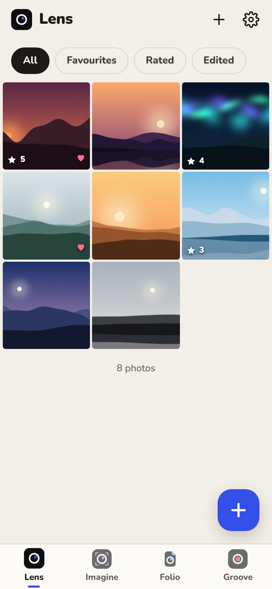</td>
    <td width="25%">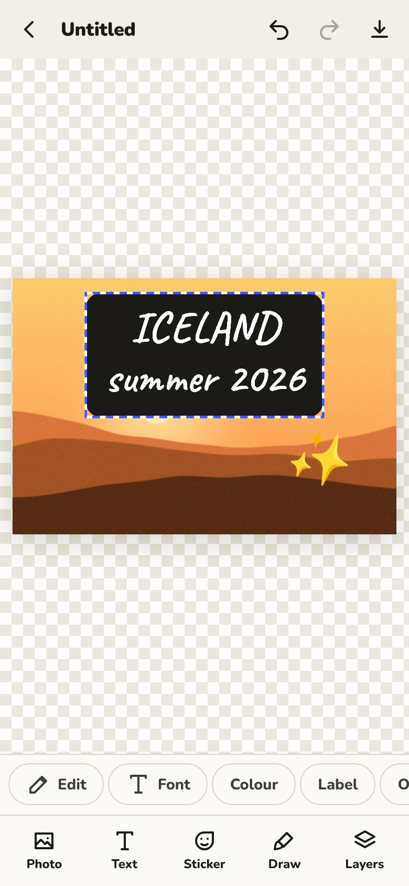</td>
    <td width="25%">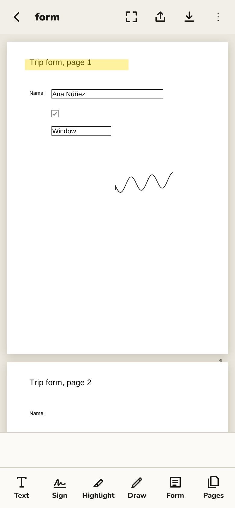</td>
    <td width="25%">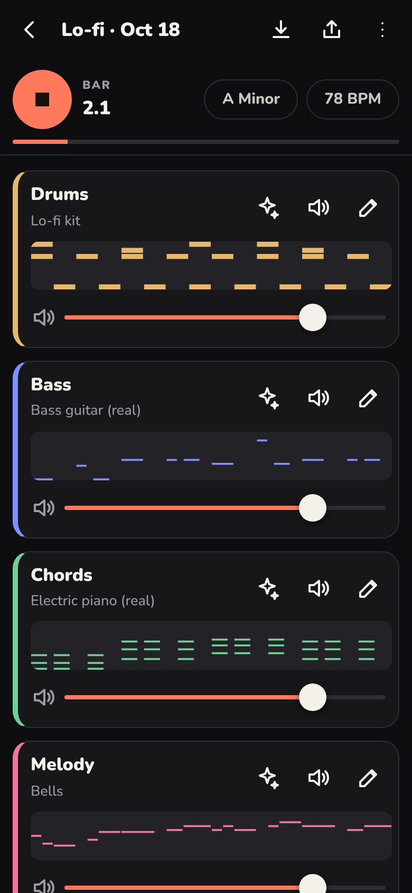</td>
  </tr>
</table>

##  Lens

Your photos, rated and developed.

- Bring photos in with the phone's own photo picker. Rate them with stars, mark favourites, and filter by favourites, rated or edited.
- Swipe between photos; double-tap or pinch to zoom.
- **Develop:** exposure, contrast, highlights, shadows, whites, blacks, warmth, tint, vibrance, saturation, fade, vignette, sharpen and grain, plus ten filters.
- **Crop** to free or fixed shapes (square, 4:5, 3:2, 16:9…), rotate, flip and straighten.
- Hold the photo to compare with the original. Undo and redo.
- Edits are kept as settings, so the original never changes. **Save copy** writes the developed photo at full size to `Pictures/Opia`.

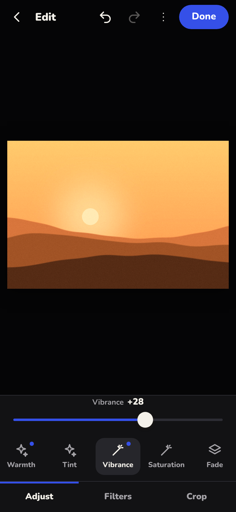 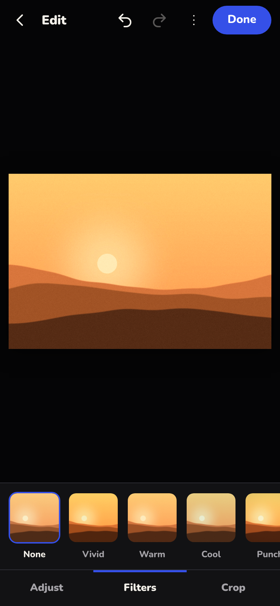

## 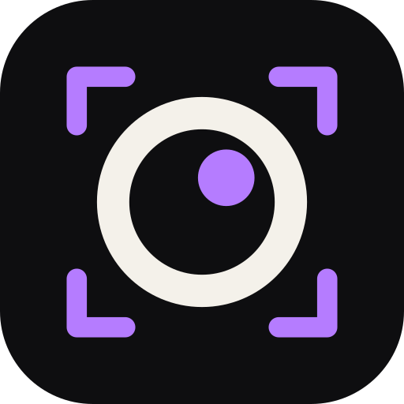 Imagine

Layers you move with a finger.

- Start from a page size (square, post, story, wide) or a photo, from the phone or from Lens with its edits.
- Add photos, **text** (five fonts, any colour, a label behind it), **stickers** and **drawings**, each on its own layer.
- Drag to move; pinch to resize and turn. It snaps to straight.
- Hide, reorder and fade layers. The eraser only rubs out its own drawing. Undo and redo.
- Pictures save as you go, and export as PNG or JPEG to `Pictures/Opia`.

## 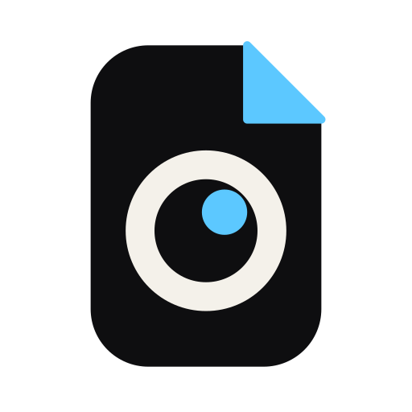 Folio

Fill it in and sign it, on the bus.

- Open any PDF. **Fill in its form**: text fields, tick boxes and lists.
- **Sign** with your finger. Signatures are kept for next time.
- Add **text**, **highlights** and **drawing**, then move, resize or delete them.
- **Pages:** turn, move, copy and delete.
- Save to `Download/Opia` or share. **Revert** takes you back to the PDF as you opened it.

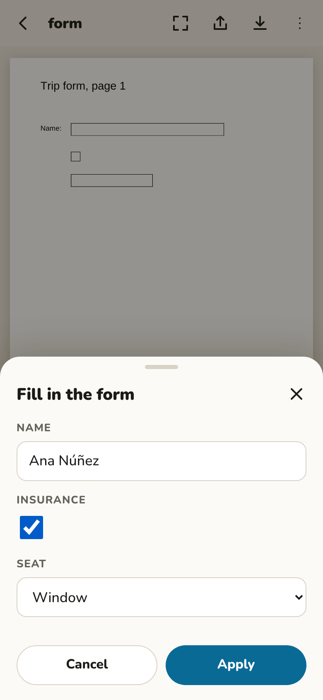

##  Groove

A song in one tap, then make it yours.

- Pick a style (lo-fi, pop, house, trap, rock, ambient) and Opia writes **drums, bass, chords and melody** that fit together.
- Change any part on a grid of steps. Everything stays in the song's key and scale, so every note fits.
- Swap instruments, including real recorded piano, guitar, bass, strings and more. Change the drum kit, tempo, key, scale and riff length, and mix each part.
- **Record your voice** over the song.
- Save as WAV to `Music/Opia`.

It uses the same music engine as Opia for Windows.

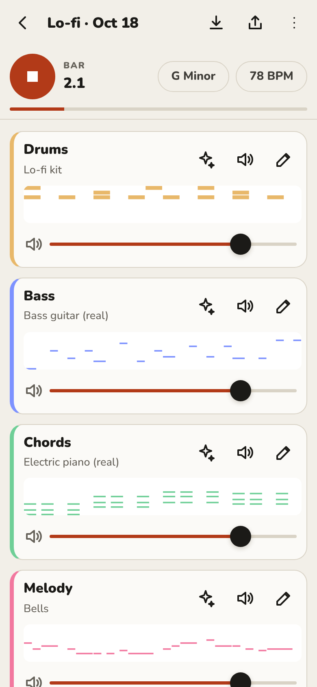 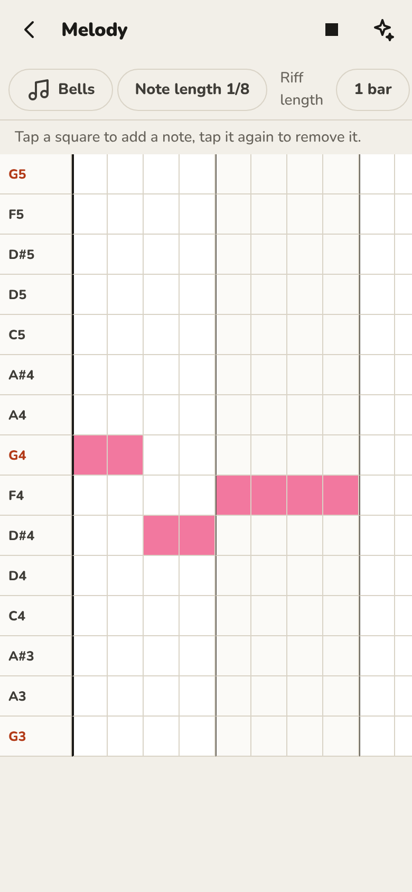

## 🧩 Home-screen widgets

Long-press your home screen, tap **Widgets** and find **Opia**:

| Widget | Size | What it shows |
| --- | --- | --- |
| **Quote of the day** | 3 × 4 | A quote worth thinking about, with who said it, where and when. Tap the shuffle button for another. |
| **Quote of the day, short** | 3 × 1 | A short quote in one line. |
| **Photo of the day** | 2 × 2 | A different photo from Lens every day, favourites first. |
| **Favourites** | 4 × 1 | Your latest four favourite photos. |
| **Quick create** | 4 × 1 | Add photos, New picture, Open PDF, or Start me off (a fresh song, playing). |
| **Recent PDFs** | 3 × 2 | Your last three PDFs, one tap to reopen. |
| **Pick up where you left off** | 2 × 2 | The last picture, PDF or song you worked on. |

The quotes come with the app: 218 of them from 161 people, from Seneca, Confucius and Marcus Aurelius to Feynman, Baldwin, Le Guin, Pratchett and lines from film and TV. Each one is traced to the speech, book, letter or film it comes from, shown underneath with the year it was said or published ("c." when the date is approximate). The full list, with where each was checked, is in [QUOTES.md](QUOTES.md). Quotes that are often misattributed are left out. The other widgets show what Opia last saved, so they update when you use the app. All of them can be resized.

## 🔄 Updates

The first time you open it, Opia asks whether it may check GitHub for new versions. Nothing about you or your files is sent. If you say yes, it checks once a day (switchable in **Settings → Updates**, where there's also **Check for updates**).

When there's a new version, it shows what's new and offers **Update now**. It then downloads `Opia.apk` and checks that it really is a newer Opia, signed for this app. Android's own installer finishes the job: you tap **Install**, and your work stays.

Usually it doesn't download the whole app. Each release comes with small patches from the five releases before it, typically about 25 KB against 6 MB for the full APK. Opia downloads the patch for the version you have and rebuilds the new APK from the one installed. The patch names the exact APK it starts from and the exact APK it makes, both by SHA-256, so it can only ever produce the published APK. If anything doesn't match, Opia downloads the whole APK instead. Android still installs the complete app, as it does for every app, Play Store ones included. Only the download gets smaller. The first time, Android also asks you to **allow Opia to install updates**, and the app walks you through that.

## 📲 Install

1. On your phone, open **[Opia.apk](https://github.com/kanisakhpara-devs/Opia-for-Android/releases/latest/download/Opia.apk)** (about 6 MB).
2. Open the downloaded file. Android asks once to let your browser install apps; allow it.
3. That's it. New versions install over the old one, and your work stays.

It needs **Android 10 or newer**. It isn't on the Play Store, so Play Protect may say it doesn't recognise the app; that's normal for any app installed from outside the store. Only install Opia from this repository's [Releases](https://github.com/kanisakhpara-devs/Opia-for-Android/releases).

## ✨ Also in the app

- **Light and dark**, following the phone or your choice. **English and Spanish.**
- **A back button that makes sense:** it closes the top sheet or screen first, and leaves the app only when nothing is open.
- **For screen readers:** every button and slider has a spoken name, and an automated accessibility check (axe-core) passes in every theme: Dark, Light, Midnight Teal and Lilac Haze. Pick one in **Settings → Theme**, or leave it on Like the phone.
- **Saves where you look:** Pictures, Music and Download, each in an Opia folder. Share sends files straight to other apps.

## 🔒 Private by design

Your photos, pictures, PDFs and songs live in the app's own storage until you save or share a copy. Opia goes online for **one thing only**: checking this repository's releases for a new version, and only after it has asked you and you've said yes. You can turn it off in Settings. Only `Updater.java` can go online, and only to GitHub; the app's screens can't reach the internet at all. The only other permission it asks for is the **microphone**, and only when you record in Groove.

## 🛠 How it's built

| Folder | What's in it |
| --- | --- |
| `www/` | The app: plain HTML, CSS and JavaScript, written the same way as Opia for Windows' interface. |
| `www/js/music-engine.js`, `www/samples/` | Groove's engine and instrument samples, copied from Opia for Windows (`web/js/music-engine.js` and `web/samples/`). When one changes, copy it across. |
| `www/vendor/` | [pdf.js](https://mozilla.github.io/pdf.js/) 3.11.174 (Apache 2.0, run with `isEvalSupported: false`) to show PDFs, and [pdf-lib](https://pdf-lib.js.org/) 1.17.1 (MIT) to change them. |
| `android/` | A small Android app in Java, using no libraries beyond Android itself. It shows `www/` in a WebView, serving the files from inside the APK so nothing touches the network. It adds the photo and file pickers, saving through MediaStore, sharing, the microphone and the back button. |
| `docs/` | The [website](https://kanisakhpara-devs.github.io/Opia-for-Android/), served by GitHub Pages. |

**Builds:** every push to `main` that changes the app is built by GitHub Actions (`.github/workflows/android.yml`) and published as a new release. The newest is always at `releases/latest/download/Opia.apk`.

**Build it yourself:** install the Android SDK and JDK 17, then run `gradlew assembleRelease` in `android/`. To try the app in a browser instead, serve `www/` (for example `python -m http.server -d www`) and open it at phone size.

**Signing:**
- Until a private key is set up, builds are signed with `android/opia-public.jks`, a key that is public on purpose so every build installs over the last.
- Anyone could sign an app with that key, so only install Opia from this repository.
- To switch to a private key, add four repository secrets: `OPIA_KEYSTORE_BASE64` (the keystore, base64), `OPIA_KEYSTORE_PASSWORD`, `OPIA_KEY_ALIAS` and `OPIA_KEY_PASSWORD`.
- Switching key means uninstalling the old app once, which deletes its data, so save anything you want to keep first.

## 🧭 Honest limits

- **New and lightly tested:** it's been tested in a phone-sized browser and builds cleanly, but hasn't been tried on many real phones yet. Please report problems as issues, with a screenshot.
- **Photos:** JPEG, PNG, WebP, GIF and AVIF open. HEIC photos and RAW files open only if the phone's browser engine can decode them, and most can't.
- **PDFs:**
  - Text you add uses Helvetica, which covers Western European letters; others are left out, and the app tells you.
  - Password-locked PDFs can be viewed but not changed.
  - Marks are written into the page when you save. Changing pages writes in the marks added so far.
- **Groove:** voice recordings are lined up using the delay the phone reports, which is close but not exact on every phone. Wear headphones, or the music is recorded too.
- **Storage:** uninstalling the app or clearing its storage deletes your library. Copies saved to Pictures, Music and Download stay.
- **Updates aren't silent:** Android always asks you to confirm an install. Only apps from the Play Store update without asking.
- **Not here yet:** Motion (video), and syncing with Opia for Windows.

## 💬 Need help?

Message Opia's help number on WhatsApp: **[+91 8450973767](https://wa.me/918450973767)**. Messages are preferred; calls may not be answered. The app has it too, under Settings › Help.

## 📜 Credits and licences

- PDF viewing: **pdf.js**, Apache License 2.0 (`www/vendor/pdfjs/LICENSE.txt`). PDF editing: **pdf-lib**, MIT (`www/vendor/pdf-lib-LICENSE.md`).
- Instrument samples: **Fluid R3 GM SoundFont** by Frank Wen, Creative Commons Attribution 3.0 (`www/samples/CREDITS.md`).
- Typefaces: **Nunito** and **Caveat**, SIL Open Font License (`www/fonts`).
- The pictures in the screenshots were generated for them; they aren't real photos.

Opia hasn't chosen an open-source licence yet, so for now the code is shared to look at and build, not to reuse.
